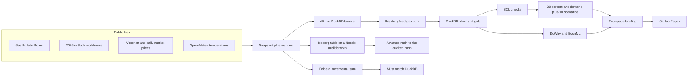

# East-coast gas reservation gap

Would holding back a fifth of Gladstone's LNG exports close the southern states' winter gas gap, and how much would be left over?

The Domestic Gas Reservation Bill is in the Senate. The design under discussion starts obligations on 1 January 2028, caps the hold-back at 20 percent of exports, and asks the Australian Energy Regulator to set the amount from forecast demand plus 10 percent. Western Australia already has its own reservation and is outside this east-coast system. AEMO's 2026 Gas Statement of Opportunities says that report did not model a domestic reservation scheme.

This project answers the volume question from public files only. It does not re-solve AEMO's network model, and it is not a contracting or investment recommendation.

[](https://github.com/LuciferDataEngineer/gas-reservation-gap/actions/workflows/ci.yml)
[](https://github.com/LuciferDataEngineer/gas-reservation-gap/actions/workflows/pages.yml)
[](LICENSE)

Live briefing: [https://luciferdataengineer.github.io/gas-reservation-gap/](https://luciferdataengineer.github.io/gas-reservation-gap/)

Figures below are from the snapshot taken **20 November 2026, 9:14 am AEDT**. Bulletin-board gas days run to **18 November 2026**. Cargo records run to **30 September 2026**. Victorian prices run to **31 October 2026**. Sydney and Adelaide prices run to **30 September 2026**.

## Headline result

**A fifth of one average export day is bigger than the 2029 peak-day hole in AEMO's full outlook. It is not bigger than that hole if storage is left out. And the gas is at Gladstone, not in Melbourne.**

| | Figure | What it is |
| --- | ---: | --- |
| Shipped from Curtis Island, 2025 | **1,336.0 PJ** | Cargo energy |
| A fifth of those cargoes | **267.2 PJ** | The 20 percent cap on 2025 exports |
| Gas the three plants took, 2025 | **1,423.1 PJ** | Bulletin-board feed gas. A fifth of an average day is **780 TJ** |
| 2029 busiest day, full outlook | **135 TJ short** | 21 June 2029, after local gas, the north-south pipe and storage |
| Left over that day, on paper | **644 TJ** | 780 minus 135, only if the gas can reach the south |
| Same day without storage | **1,098 TJ short** | 780 TJ does not cover it |
| Southbound pipe, published limit | **512 TJ/day** | South West Queensland Pipeline, westbound. Already in the outlook |
| 2030 busiest day, full outlook | **257 TJ short** | Still under 780 TJ |
| Southern annual gap, middle outlook | **0 until 2028, 1.3 PJ in 2029, 12.2 PJ in 2030** | A fifth of that year's LNG line covers it, with on the order of 270 PJ left |
| 2028 obligation if demand-calibrated | **271.9 PJ** | Home and business use plus 10 percent is larger, so the 20 percent cap binds |
| Iona, winter 2026 | **11.8 PJ drawn** | 24.8 PJ on 31 May to 13.0 PJ on 31 August. Full before winter |
| Iona on 18 November 2026 | **9.7 PJ** | Still lower than the end of winter |
| Longford average day | **835 TJ in 2022, 508 TJ so far in 2026** | About 39 percent lower |
| Melbourne 6am price, June–August | **$30.86 in 2022, $12.53 in 2025, $9.08 in 2026** | 2025 matches the figure on AEMO's 2026 winter card |

Feed gas in 2024 was **1,439.0 PJ**. The outlook's LNG line for 2024 is the same number, within a tenth of a petajoule. That is the cross-check that the bulletin-board total is the series AEMO itself uses.

The price check does not show a clear Melbourne price change from the plants taking more gas, once the cold, Victorian demand and Longford supply are held steady. The estimated move is about three cents per gigajoule for an extra 100 TJ. Method and the refutation tests are in [INSIGHTS.md](INSIGHTS.md). The briefing pages do not use those terms.

## Architecture



CI rebuilds the pages from the committed snapshot. It does not call the live sources. Refreshing the snapshot is a deliberate local run of `make snapshot`.

## Tech stack

| Piece | Why it is here |
| --- | --- |
| dlt into DuckDB | Loads the snapshot parquet into a bronze schema. DuckDB is the warehouse. No Postgres and no hosted database. |
| Ibis | The same feed-gas sum is computed through Ibis on that DuckDB file. The build stops if it disagrees with SQL by more than 0.01 TJ. |
| Apache Iceberg and Project Nessie | Daily feed gas is written to an Iceberg table on a Nessie branch named `audit`. The sum is checked there. Only then is `main` moved to that hash and read back. Nessie's merge call rejects the catalog's first commits, because they do not share the empty repository root as a merge ancestor, so the publish step is a fast-forward of `main`. A failed check leaves `main` where it was. |
| RustFS | S3-compatible object store for the Iceberg files. The MinIO images could not be pulled anonymously: Docker Hub returned "repository does not exist" and Quay returned 401. RustFS is Apache-2.0. |
| Feldera | Incremental SQL (DBSP) totals the same feed-gas rows. DuckDB runs the identical sum. CI fails if they differ. The published image is about 11 GB, so this job is the heavy one on a free runner. |
| DoWhy and EconML | A linear backdoor estimate and a linear double machine-learning estimate of the Melbourne 6am price against feed gas, with weather, Victorian demand, Longford supply and a winter flag. Placebo, random-cause and subset refutations are recorded. |
| DuckDB SQL checks | Ten checks: row counts, three plants, non-negative feed gas, duplicate days, Iona range, the 2024 cross-check, actual and outlook coverage, heating degrees, positive prices, and the 512 TJ/day pipe figure. |
| pytest, ruff, Playwright | Unit tests for the reservation arithmetic, a full rebuild test, and a browser test at 1280px and 390px that fails if chart labels overlap or stick out of the frame, or if the four big-number cards wrap onto a second row on a desktop width. |
| Docker Compose | RustFS, Nessie and Feldera for the local and CI engine jobs. The page rebuild itself is a single Python process and has its own image. |
| GitHub Pages | Static four-page briefing via `actions/deploy-pages`. |

## What's new vs the previous project

Project 16, [dry-summer-water-watch](https://github.com/LuciferDataEngineer/dry-summer-water-watch), asked which town-water storages were already under a planning line and which lever could refill them. It used Temporal child workflows, RisingWave streaming SQL, KEDA on kind, a Chronos-Bolt forecast, DuckDB and Polars.

This project asks a different question, about gas rather than water, and swaps the engine set:

- Nessie branches replace Temporal workflows as the way a write is isolated, checked, and only then published.
- Feldera's incremental SQL replaces RisingWave. The check is still "the streaming total equals the DuckDB total".
- dlt replaces the hand-rolled activity that landed files.
- Ibis replaces the Polars cross-check, still against DuckDB.
- DoWhy and EconML replace the time-series forecast. The question here is whether export-plant gas lines up with the Melbourne price after the cold and demand are taken into account, not what the next 64 days of a storage will do.
- The object store is RustFS rather than a database volume, because the Iceberg table needs an S3 API and the MinIO images were not anonymously pullable.

DuckDB remains the default warehouse, as in the previous project.

## Data sources

All of these are free to download with no API key. Hashes, byte sizes and the access time are in [`data/snapshot/manifest.json`](data/snapshot/manifest.json). AEMO material is © AEMO. The 2026 outlook says it may be used in line with the copyright permissions on AEMO's website. Those permissions pages returned HTTP 403 from this environment, so this snapshot does **not** claim a Creative Commons licence for AEMO files. Open-Meteo is CC BY 4.0.

| Publisher | What | URL | Licence | Coverage in this snapshot | Accessed |
| --- | --- | --- | --- | --- | --- |
| AEMO Gas Bulletin Board | Actual flow and storage zip, kept as facility-days for the export plants, Longford, Iona, Otway, Orbost, Lang Lang, Athena, Minerva and Moomba, plus southern pipeline deliveries by state | https://nemweb.com.au/Reports/CURRENT/GBB/GasBBActualFlowStorage.zip | © AEMO, public download | Gas days 29 Sep 2018 – 18 Nov 2026 | 20 Nov 2026, 9:14 am AEDT |
| AEMO Gas Bulletin Board | LNG shipments, cargo energy in PJ | https://nemweb.com.au/Reports/CURRENT/GBB/GasBBLNGShipments.CSV | © AEMO, public download | 2,163 cargoes, through 30 Sep 2026 | same |
| AEMO Gas Bulletin Board | Quarterly LNG transactions | https://nemweb.com.au/Reports/CURRENT/GBB/GasBBLNGTransactions.csv | © AEMO, public download | Quarters from 2023. Price filled in for some quarters only | same |
| AEMO | 2026 Gas Statement of Opportunities, report figures and data | https://www.aemo.com.au/-/media/files/gas/national_planning_and_forecasting/gsoo/2026/2026-gsoo-report-figures-and-data.xlsx | © AEMO 2026 | Daily southern adequacy 2024–2030, annual gaps, consumption, LNG line, June production capacity | same |
| AEMO | 2026 GSOO supply workbook (processing, storage, pipelines, LNG projects) | https://www.aemo.com.au/-/media/files/gas/national_planning_and_forecasting/gsoo/2026/2026-gsoo-supply-data.xlsx | © AEMO 2026 | Nameplate rows for the three plants, Longford, Iona, Heytesbury and the SWQP | same |
| AEMO DWGM | Victorian wholesale prices and demand | https://www.aemo.com.au/-/media/files/gas/dwgm/dwgm-prices-and-demand.xlsx | © AEMO, public download | Daily demand and the 6am price, from 2019 through 31 Oct 2026 | same |
| AEMO STTM | Sydney, Adelaide and Brisbane prices and allocations | https://www.aemo.com.au/-/media/files/gas/sttm/data/sttm-price-and-withdrawals.xlsx | © AEMO, public download | Ex-ante price and hub allocation, from 2019 through 30 Sep 2026 | same |
| Open-Meteo | Daily mean temperature, turned into a heating degree at base 18°C | https://archive-api.open-meteo.com/v1/archive | CC BY 4.0 | Melbourne, Sydney, Adelaide and Hobart, 1 Jan 2019 – 18 Nov 2026, each city in its own timezone | same |
| AEMO | 2026 Gas Statement of Opportunities PDF | https://www.aemo.com.au/-/media/files/gas/national_planning_and_forecasting/gsoo/2026/2026-gas-statement-of-opportunities.pdf | © AEMO 2026 | Read for the statement that the outlook did not model a reservation scheme. Numbers on the pages come from the workbooks and the bulletin board, not from retyping the PDF | same |

The daily maximum-demand workbook was downloaded while scoping and was not needed once the figure workbook's daily adequacy sheet was in hand. It is not in the snapshot.

## Cleaning and transformation

1. Feed gas is the bulletin-board `Demand` of facilities typed `LNGEXPORT` only. Each plant's pipeline repeats the same quantity (APLNG pipeline matches APLNG, the Wallumbilla–Gladstone pipeline matches QCLNG, the GLNG pipeline matches GLNG). Adding the pipes would double-count.
2. Exports are shipment `VolumePJ`. They are lower than feed gas (1,336 PJ shipped in 2025 against 1,423 PJ taken). The files do not label the difference, so it is not called fuel gas.
3. Southern demand on the pages is AEMO's own daily series from the outlook workbook: residential, commercial and industrial plus gas for power. 2024 and 2025 are marked actual. 2026 to 2030 are the outlook on its reference weather year, not a diary of those future dates.
4. On 18 June 2025, pipeline deliveries into Victoria, New South Wales, South Australia and Tasmania summed to about 2,105 TJ. AEMO's southern demand that day was about 2,188 TJ. The pages use AEMO's series. Power stations and large users are not added on top of pipeline deliveries.
5. A peak-day gap is demand minus a published supply stack on the highest-demand day of that year. Positive means the stack is short. The full stack is production, expected north-south flow, deep storage, shallow storage and anticipated supply.
6. The 20 percent reserve is 0.20 times the volume named in the sentence. Future years use the outlook LNG line, because those cargoes do not exist yet.
7. The demand-calibrated obligation is the minimum of 1.10 times Step Change east-coast domestic consumption excluding gas power, and 0.20 times that year's outlook LNG.
8. Iona draw is reported inventory on 31 May minus inventory on 31 August. Heating degrees are `max(0, 18 − daily mean °C)`. The morning price is the 6am Victorian interval.
9. Empty transaction-price cells stay empty. They are not filled with a netback. These free files do not include an Asian netback.

## Data model

Bronze, committed as parquet under `data/snapshot/` and loaded by dlt:

| Table | Grain |
| --- | --- |
| `facility_day` | Facility and gas day for the plants, storages and southern producers listed above |
| `southern_pipe_day` | State and gas day, sum of pipeline demand in VIC, NSW, SA, TAS |
| `lng_shipments` | One cargo |
| `lng_transactions` | One quarter |
| `facility_reference` | One published nameplate row |
| `gsoo_adequacy_day` | One southern day, actual or outlook |
| `gsoo_annual_gap` | Year and scenario |
| `gsoo_consumption` | Year and series, including the LNG line |
| `gsoo_southern_capacity` | June maximum southern production |
| `dwgm_daily` | Victorian gas day |
| `sttm_daily` | Hub gas day |
| `hdd_daily` | City and day |

Silver is the Ibis daily feed-gas total, `silver.lng_daily`. Gold is the joined daily frame used for the price estimate, built in DuckDB and not committed. The Iceberg table `gas.lng_daily` is the same daily total, created only when Nessie is running.

## How to run

Python 3.12.

```bash
python3 -m venv .venv
.venv/bin/pip install -r requirements-dev.txt
make test
make pipeline
```

`make pipeline` reads only `data/snapshot/` and rewrites `site/` and `INSIGHTS.md`.

Refresh the snapshot from the public sources. This uses the network and is not part of CI:

```bash
make snapshot
make pipeline
```

Docker, page rebuild only:

```bash
docker compose build
docker compose run --rm --build pipeline
```

The Compose file's `pipeline` service is the image above. RustFS, Nessie and Feldera are separate:

```bash
docker compose up -d rustfs nessie feldera
make iceberg
make feldera
```

Nessie reaches RustFS through the host's published port, using the name `s3host`. On the machine running the check that name is `127.0.0.1` (`echo "127.0.0.1 s3host" | sudo tee -a /etc/hosts`), because the catalog hands the same name to the client. Inside Compose it points at the Docker host gateway. Nessie is on port 19120 with authentication off, warehouse `s3://gas-warehouse/`. RustFS is on port 9000 with `rustfsadmin` / `rustfsadmin`. Feldera is on port 8080.

The briefing is static files in `site/`. From that directory, `python3 -m http.server` is enough. Links are relative, which is what GitHub Pages needs for a project site.

## Testing and CI

[`.github/workflows/ci.yml`](.github/workflows/ci.yml) runs on pull requests and on main:

1. **core** — ruff, the reservation arithmetic, a full rebuild from the snapshot, plain-language checks on the four pages, and Playwright at 1280×800 and 390×844.
2. **iceberg** — RustFS and Nessie. Write the daily feed-gas table on branch `audit`, check the sum, merge to `main`, read it back.
3. **feldera** — the pipeline-manager image. Incremental sum of 180 feed-gas rows against DuckDB. The development compile profile is used so the job finishes on a free runner. The image is about 11 GB.

[`.github/workflows/pages.yml`](.github/workflows/pages.yml) deploys `site/` with `actions/deploy-pages` on push to main.

Randomness in the refutation tests and the double machine-learning fit is seeded (`17`). The reservation arithmetic has no random draw. Floats on the pages are rounded before they are written. The pages stamp the snapshot time, not the run time.

## Limitations

- The outlook already counts the north-south pipe and Iona's withdrawal. Holding gas back at Gladstone does not put it in Melbourne on the same day. Iona started winter 2026 full (24.8 PJ reported, against a published maximum of 24.4 PJ), so there was no empty tank in late May to park extra gas.
- 2026 to 2030 daily demand is a reference-weather outlook. The date "21 June 2029" is the day in that published profile, not a forecast that 21 June will be the cold day.
- Longford's facility row lists 720 TJ/day in the capacity column and about 1,175 TJ/day in the same row's description. Measured supply averaged 835 TJ/day in 2022, which sits between those two published figures. The pages report the measured averages and both published figures.
- The 2029 deep-storage step is larger than 570 TJ/day because the Heytesbury project is listed at an extra 45 TJ/day. The 2025 and 2026 steps match Iona's published 570.
- Cargo records stop at 30 September 2026. Feed gas runs to 18 November 2026. Neither 2026 file is a full year, and neither is annualised into a pretend total.
- Adelaide's June–August 2025 ex-ante average here is $13.35/GJ. AEMO's winter card prints $13.22 for Adelaide. Melbourne ($12.53) and Sydney ($13.21) match that card to the cent. The difference is left as a difference.
- No free file in this set is an export netback. Quarterly transaction prices are shown only where AEMO filled the cell.
- The price estimate is observational. It is not the effect of the bill.
- Western Australia is out of scope. The Northern Territory LNG plants are not in the Curtis Island total; the outlook's LNG line, which matches Curtis Island feed gas, excludes them too.
- Not operational advice. Do not ship, store, or contract from this page.

## Next steps

- When the bill's final text names the demand the Regulator must use, replace "east-coast home and business use, excluding gas power" with that definition.
- A southbound capacity expansion that is only described in the PDF, and not as a cell in the pipeline sheet, should be added when AEMO publishes it as a number in the supply workbook.
- A free netback series, if one is published without a key, would let the pages compare the domestic morning price with the export alternative.
